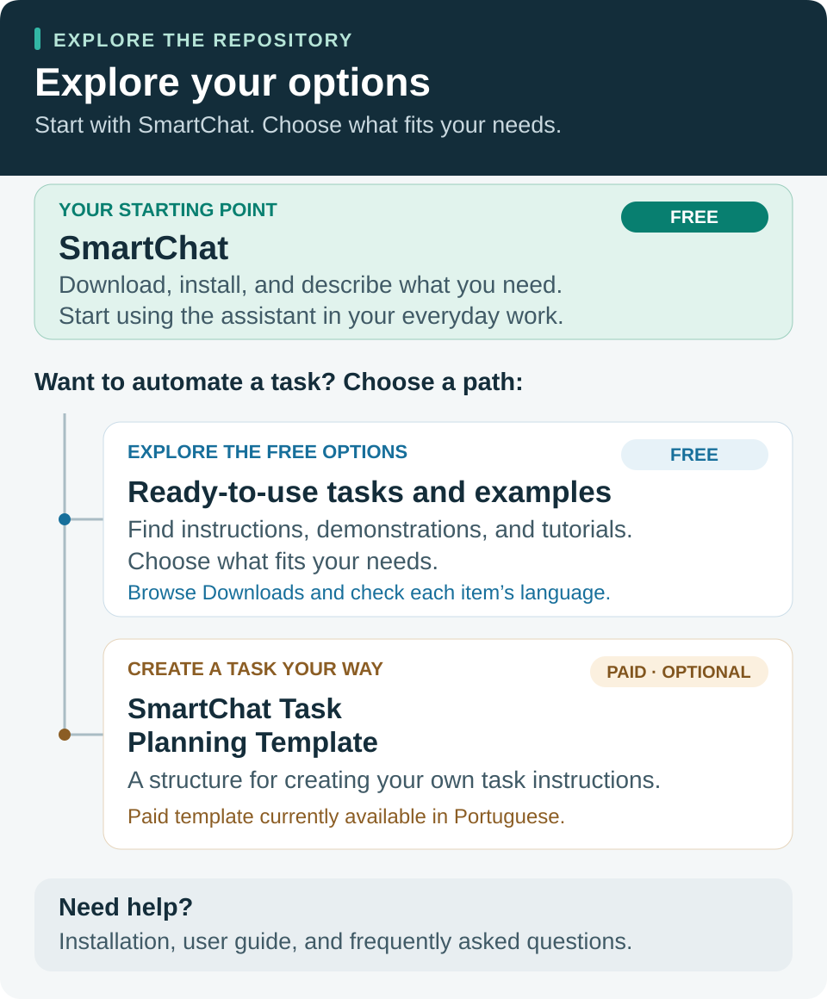

# SmartChat

**English** | [Português](README.pt-BR.md)

**An assistant that helps clarify what you need before building a response.**

SmartChat structures the conversation to understand your goal, identify relevant information, examine assumptions, and develop a response suited to your work. Start by explaining what you need in your own words.

Established and in use since April 2026. Version available in this repository: **0.38.3**.

## Where to start

Start with the free SmartChat plugin. To automate a task, explore the free ready-to-use tasks and examples, or learn about the template for creating your own instructions. Choose what fits your needs.

**Explore each option:**

- **[Get started with SmartChat](downloads/smartchat/README.md)** — download and installation guidance.
- **[Explore ready-to-use tasks and examples](downloads/README.md)** — free materials, demonstrations, and tutorials, with language and scope listed for each task.
- **[Learn about the Task Planning Template](downloads/README.md#create-your-own-tasks)** — a paid, optional template, currently available in Portuguese.

**Help:** [Installation](docs/instalacao.md) · [User guide](docs/uso.md) · [Frequently asked questions](docs/faq.md).

## Download and get started

### [⬇ Download SmartChat for free — version 0.38.3](https://github.com/ubirajaratheodoro/smartchat/raw/refs/heads/main/downloads/smartchat/smartchat-v0.38.3.zip)

1. Read the [free-use license](LICENSE.md).
2. [Download SmartChat v0.38.3](https://github.com/ubirajaratheodoro/smartchat/raw/refs/heads/main/downloads/smartchat/smartchat-v0.38.3.zip).
3. Follow the [installation guide for ChatGPT and Codex](docs/instalacao.md).
4. Start a new conversation, select SmartChat, and describe the outcome you want.

Download only the ZIP using the link above. You do not need to download the entire repository or choose between multiple folders. The original package is unchanged. These English pages explain how to use it; they do not provide a separately translated plugin package.

## What you can do

- Structure an idea or request before carrying it out.
- Analyze a proposal, compare alternatives, and clarify decision criteria.
- Organize information to create a document or solve a problem.
- Create task instructions that you can review and test.

Example starting messages:

> Use SmartChat to help me structure a service proposal. Here is the information I have: [...].

> Use SmartChat to help me analyze this decision. My goal is [...], and my constraints are [...].

> Use SmartChat to help me turn this recurring activity into a documented task: [...].

See the [user guide](docs/uso.md) for ways to guide the conversation.

## Downloads and tutorials

Find the files and their instructions in one place:

- **[SmartChat](downloads/smartchat/README.md)** — the free plugin and installation guide.
- **[Financial reconciliation — Portuguese only](downloads/conciliacao-financeira/README.pt-BR.md)** — a ready-to-use task, tutorial, video, and fictional sample spreadsheet. Prepared for use in Brazil, for one bank account in Brazilian reais (BRL) over one month. It is not adapted to other countries.

[Browse all downloads](downloads/README.md). Each task lists its available language and scope.

## Create your own task

You can use SmartChat for free to organize your activities. If you want a predefined structure to work from, the **SmartChat Task Planning Template** is a separate paid product.

Attach the template, explain the task, and answer the questions. SmartChat helps prepare a file with instructions for you to review and use later.

[See how the template works](downloads/README.md#create-your-own-tasks).

The product is currently offered in Portuguese under the name **Modelo de planejamento de tarefas com SmartChat**. The English explanation here does not mean that an English edition of the paid file is available.

The [standard financial reconciliation task (Portuguese only)](downloads/conciliacao-financeira/README.pt-BR.md) is already prepared and free to use; buying the template is not required.

## Free, including for professional use

You may use SmartChat for your work and to provide services to clients. You may also create, adapt, and deliver your own tasks, prompts, documents, and other outputs.

This permission does not include modifying or redistributing the SmartChat plugin. See the [license](LICENSE.md), which also addresses viewing and forking rights under GitHub's terms. Public and free availability does not make it open-source software.

SmartChat itself is free. Accounts, plans, limits, and external tools follow their providers' terms. Installation availability depends on your environment and account permissions.

## Questions and problems

Read the [FAQ](docs/faq.md). To report a problem, [open an issue](https://github.com/ubirajaratheodoro/smartchat/issues/new) with your environment, version, and steps to reproduce it. Remove personal information, client documents, and confidential information before posting.

Public support does not include individual consulting or a guaranteed response time. You can submit suggestions through issues; the project maintainer manages plugin releases.

## Files and integrity

The installation package is in [downloads/smartchat](downloads/smartchat/README.md). The optional [integrity check](downloads/smartchat/SHA256SUMS.txt) helps verify that the download is complete.

SmartChat guides interaction with AI; important results need review. It uses the tools and permissions available in its environment. Mentioning a file or service alone does not grant access to it.
