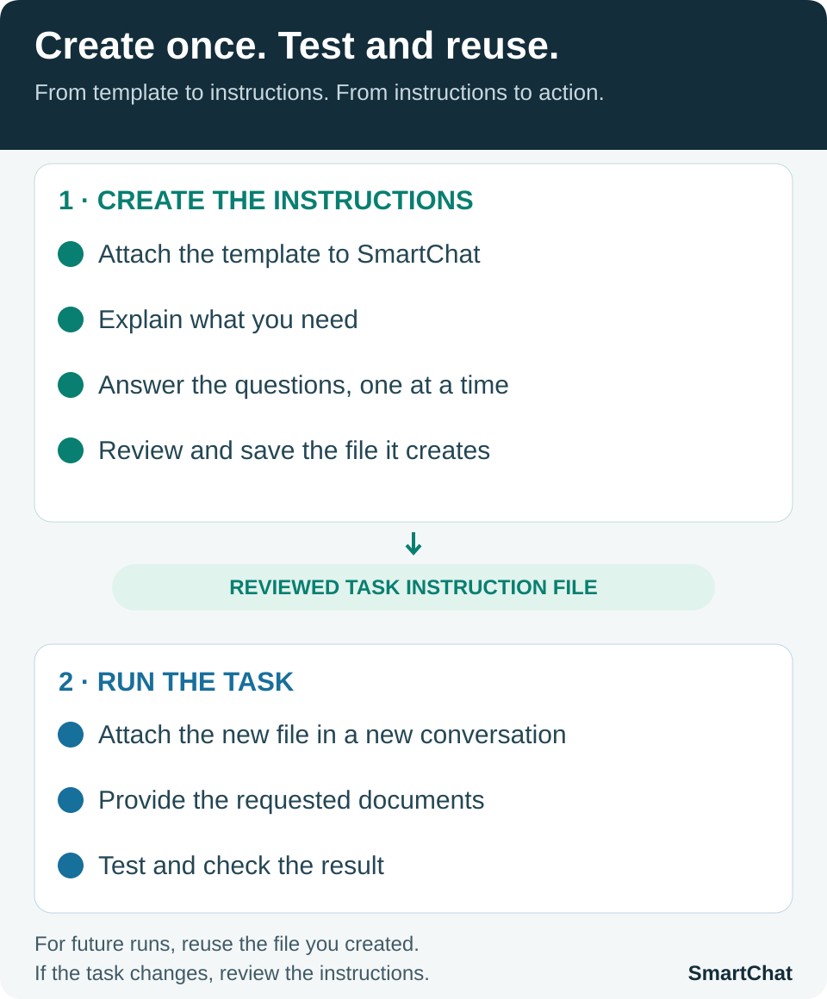

# Downloads and tutorials

[Português](README.md) | **English**

Find free files and guidance for using them. Each folder groups the materials for a product or task. Check the available language and scope before downloading.

| Download | What you will find | Language and scope |
| --- | --- | --- |
| **[SmartChat](smartchat/README.en.md)** | Free plugin, available version, installation guidance, and optional integrity check. | English and Portuguese guides; unchanged original package with Portuguese instructions and references. |
| **[Financial reconciliation](conciliacao-financeira/README.md)** | Ready-to-use task, full tutorial, video of its original creation, and a fictional sample spreadsheet. | **Portuguese only.** Prepared for use in Brazil: one bank account in BRL over one month. Not adapted to other countries. |

## See SmartChat in action

The [financial reconciliation demonstration — Portuguese only](conciliacao-financeira/README.md) shows how the original task was created and includes a sample result. You can also download the current standard task instructions. The assistant asks for the required information before reconciling, and the spreadsheet layout is fixed.

The task, tutorial, video, and sample spreadsheet remain in Portuguese. This English catalog does not change the task's Brazilian context or indicate that it has been validated for other countries.

## Create your own tasks

Want to plan another activity or create a task suited to the way you work? The **SmartChat Task Planning Template** is a file that guides the assistant to ask the necessary questions and help prepare your instructions.

*Turn what you need to do into instructions for AI to carry out.*

**Product language:** the paid file is currently offered in Portuguese as **Modelo de planejamento de tarefas com SmartChat**. This English explanation does not include or promise an English edition of the file.

**How to get started with the template**

1. Open a conversation with SmartChat selected.
2. Attach the **SmartChat Task Planning Template** file received with your purchase.
3. Describe your task with a simple message:

> I want to automate [describe the task]. Use the template I am attaching to help me create a file with the instructions for this task, and ask me the questions you need answered. Please respond in English.

Replace the text in brackets with your activity, such as “preparing sales proposals.” You do not need to fill in the template: answer SmartChat's questions and review the instruction file it prepares. The example message requests English output; it does not change the language of the purchased template.

This conversation is for **creating your task instructions**. After reviewing them, attach the resulting file in another conversation and request execution, providing the documents and access needed. Test the task in your environment before relying on it.

**[Learn about the SmartChat Task Planning Template — Portuguese sales page](https://sun.eduzz.com/Q9NDKAYP01).**

The template is a separate paid product and is not included in these downloads. You can use SmartChat and the standard reconciliation task for free without buying it. The Eduzz link is provisional and will be updated by the maintainer.

[Back to SmartChat](../README.en.md)
