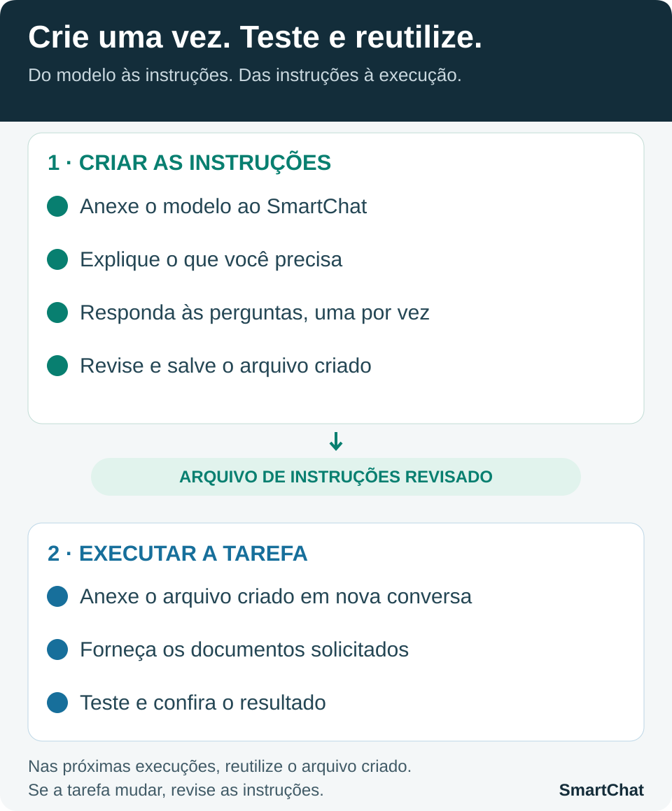

# Downloads e tutoriais

Aqui você encontra os arquivos gratuitos e as orientações para utilizá-los. Cada pasta reúne tudo o que corresponde ao produto ou à tarefa.

| Pasta | O que você encontra |
| --- | --- |
| **[SmartChat](smartchat/)** | Plugin gratuito, versão disponível, orientações de instalação e verificação opcional do download. |
| **[Conciliação financeira](conciliacao-financeira/)** | Tarefa padrão pronta para baixar, tutorial completo, vídeo da criação original e planilha demonstrativa com dados fictícios. |

## Veja o SmartChat em ação

Na [conciliação financeira](conciliacao-financeira/), você pode assistir à demonstração, conhecer o resultado e baixar as instruções para usar a tarefa. O assistente pergunta os dados necessários antes de conciliar; a planilha tem modelo fixo.

## Para criar suas próprias tarefas

Quer planejar outra atividade ou criar uma tarefa adaptada à sua maneira de trabalhar? O **Modelo de planejamento de tarefas com SmartChat** é um arquivo que orienta o assistente a fazer as perguntas necessárias e ajudar a preparar as instruções.

*Transforme o que você precisa fazer em instruções prontas para a IA executar.*

**Como começar com o modelo**

1. Abra uma conversa com o SmartChat selecionado.
2. Anexe o arquivo do **Modelo de planejamento de tarefas com SmartChat**, recebido na compra.
3. Descreva sua tarefa com uma mensagem simples:

> Quero automatizar [descreva a tarefa]. Use o modelo que estou enviando para me ajudar a criar um arquivo com as instruções dessa tarefa e me faça as perguntas necessárias.

Troque apenas o trecho entre colchetes pela atividade que deseja automatizar, por exemplo: “preparar propostas comerciais”. Você não precisa preencher o modelo: responda às perguntas do SmartChat e revise o arquivo de instruções que ele preparar.

Essa conversa serve para **criar as instruções da sua tarefa**. Depois da revisão, você poderá anexar o arquivo criado em outra conversa e pedir sua execução, fornecendo os documentos e acessos necessários.

**[Conheça o Modelo de planejamento de tarefas com SmartChat](https://sun.eduzz.com/Q9NDKAYP01).**

O modelo é uma oferta paga separada e não está incluído nestes downloads. Você pode utilizar o SmartChat e a conciliação padrão gratuitamente, sem essa compra. O link da Eduzz é provisório e será atualizado pelo mantenedor.

[Voltar à apresentação do SmartChat](../README.md)
